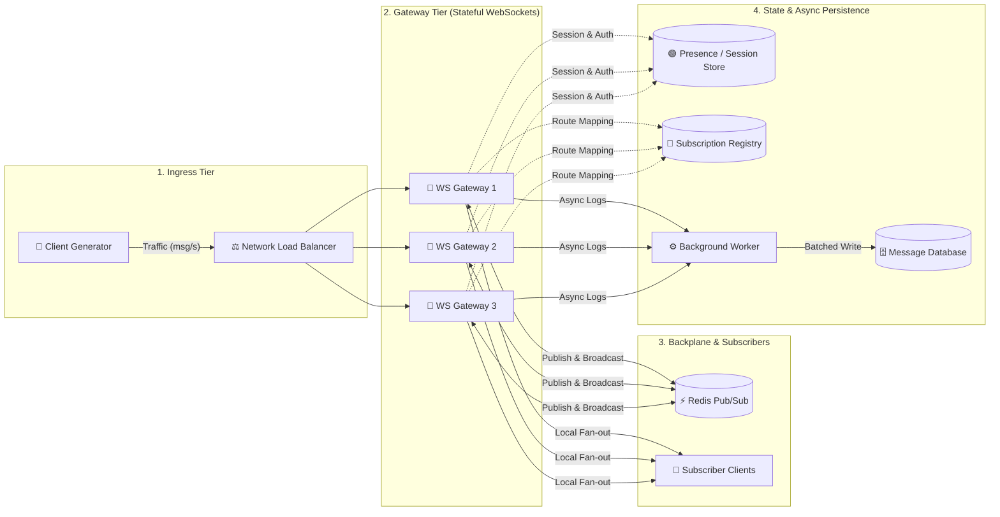

# 🌐 Distributed Systems Virtual Lab — Mini Discord (Topic 14)

> **An interactive, browser-based distributed architecture simulation and chaos engineering laboratory for Real-Time Pub/Sub WebSocket Gateways.**

[](https://react.dev/)
[](https://www.typescriptlang.org/)
[](https://vitejs.dev/)
[](https://tailwindcss.com/)
[](https://vitest.dev/)
[](#)

---

## 👥 Team Details

| Name | Roll Number | Class / Division |
| :--- | :--- | :--- |
| **Tanvi Jagade** | **D12B-19** | D12B |
| **Riya Bhatt** | **D12B-07** | D12B |

---

## 📌 Project Overview

Modern real-time communication platforms (like Discord, Slack, and WhatsApp) handle millions of persistent WebSocket connections concurrently while synchronizing chat messages across distributed servers. 

This project simulates a **Real-Time Pub/Sub WebSocket Gateway (Mini Discord)** entirely client-side in the browser. It provides students and engineers with a virtual playground to explore:
- Scaling WebSocket connections across multiple gateway instances.
- Inter-gateway fan-out using a **Redis Pub/Sub** backplane.
- Latency, queue build-ups, and backpressure under varying offered loads.
- Failure injection (gateway crashes, Redis outages, slow consumers, and network partitions).
- System bottlenecks and recovery dynamics.

---

## 🏛️ System Architecture



### Component Breakdown

1. **Client Generator**: Synthesizes client ingress traffic with configurable offered loads (from 1 to 5,000+ msg/s).
2. **Network Load Balancer (NLB)**: Distributes active client TCP/WebSocket connections across healthy gateways using health-check intervals and rebalance rates.
3. **WebSocket Gateways (`gw1`, `gw2`, `gw3`)**: Ingest messages, manage persistent connections, perform local fan-out to locally attached clients, run heartbeat watchdogs, and forward cross-node messages to Redis.
4. **Redis Pub/Sub Backplane**: High-speed ephemeral broadcast backplane distributing messages to peer gateways while filtering origin nodes to prevent duplicate delivery.
5. **Presence & Subscription Registry**: State stores governing admission control, user presence tracking, and topic subscription mappings.
6. **Async Persistence Pipeline (Worker → Database)**: Decoupled message persistence path preventing database write latency from degrading the real-time broadcast path.

---

## ✨ Key Features

- **Interactive Topology Canvas**:
  - Drag-and-drop node placement and customizable edge routing using `@xyflow/react`.
  - Node inspection panel: dynamically tune capacity, edge latency, queue limits, timeouts, retries, and failure probabilities.
  - Interactive minimap, smooth zoom/pan, fit-to-screen (`F`), and multi-select.
- **High-Performance Simulation Engine**:
  - Discrete-time, deterministic 100 ms tick engine decoupled from React rendering.
  - **Fluid Cohort Model**: Work moves as smooth batches with fractional message counts, yielding reproducible and stable performance characteristics.
  - **Mulberry32 PRNG**: Deterministic pseudo-random service jitter (±20%) controlled via seed configuration.
- **Chaos Engineering & Failure Lab**:
  - Inject gateway crashes, Redis disconnections, database outages, partition splits, traffic spikes (e.g., 6× load surge), and slow consumer scenarios.
- **Comprehensive Observability**:
  - Live rolling P50, P95, and P99 end-to-end latency histograms (10-second rolling window).
  - Node health indicators (`% BUSY`, `WAITING`, queue depth, error rates).
  - Automated bottleneck detector explaining root causes in real time.
  - Interactive message tracing highlighting routing paths across the canvas.
- **State Management & Portability**:
  - Multi-level Undo / Redo history stack.
  - Auto-drafting to browser `localStorage`.
  - JSON architecture export and import.

---

## 🧪 Pre-Configured Experiments

Access reproducible distributed systems experiments directly from the **Experiments** panel:

| Experiment | Description | Failure Injected | Key Observation |
| :--- | :--- | :--- | :--- |
| **Healthy Baseline** | 100 msg/s across 3 gateways | None | Normal queue depths, sub-millisecond P99 latency. |
| **Gateway Overload** | 600 msg/s offered (200 msg/s per 150-capacity gateway) | Load surge | Queues saturate, timeout retries kick in, message drop rate rises. |
| **Redis Bottleneck** | Redis capacity throttled to 60 ops/s at 120 msg/s | Capacity cap | Redis queue overflows while gateways remain underutilized. |
| **Redis Outage** | Redis crashes at $t = 10\text{s}$ for $15\text{s}$ | Total crash | Local message delivery survives; cross-node broadcasts drop. |
| **Redis Outage + Gateway Buffer** | Outage with gateway publish buffering enabled | Crash + buffer | Messages are preserved in gateway queues and flushed upon Redis recovery. |
| **Single Gateway Crash** | Gateway 1 crashes at $t = 10\text{s}$ for $25\text{s}$ | Node crash | NLB detects death after health-check delay; surviving gateways absorb load. |
| **Traffic Spike** | 6× surge in offered load for $10\text{s}$ | Surge | Tests queue absorption and backpressure propagation. |
| **Slow Subscribers** | Subscriber capacity reduced to 10% | Slow consumer | Backpressure or drop-tail queues trigger due to fan-out amplification. |

---

## 🧮 Simulation Mathematical Model

- **Queue Dynamics**: Every component implements a FIFO queue with bounded capacity $C$ and queue limit $Q_{\max}$:
  $$\text{Utilization} = \frac{\text{Units Served in } [t-2\text{s}, t]}{C \times 2\text{s}}$$
- **Latency Model**:
  $$\text{Total Latency} = \text{Edge Latency} + \text{Queue Wait Time} + \text{Processing Time} \pm \text{Jitter}$$
- **Error Metric**:
  $$\text{Error Rate} \approx \frac{\text{Lost Message Equivalents}}{\text{Offered Load}}$$
- **Redis Fan-Out**: Total deliveries per message equal subscriber fan-out $F$, partitioned across connected gateways:
  $$\text{Deliveries} = \text{Admitted Messages} \times F$$

---

## 🛠️ Tech Stack

- **UI Framework**: React 19, TypeScript
- **State Store**: Zustand (state persistence, snapshot history, undo/redo)
- **Canvas & Nodes**: `@xyflow/react` (React Flow)
- **Styling**: Tailwind CSS v4, Vanilla CSS Design System
- **Icons**: Lucide React
- **Data Visualization**: Recharts
- **Test Runner**: Vitest (37 automated engine unit tests)
- **Bundler**: Vite 8 with Rolldown bindings

---

## 🚀 Getting Started

### Prerequisites
- Node.js 18+ (Node 20+ recommended)
- npm or pnpm

### Installation & Run

```bash
# 1. Clone the repository
git clone https://github.com/haze-helloworld/System-Design-.git
cd System-Design-

# 2. Install dependencies
npm install

# 3. Start local development server
npm run dev
```

Visit [`http://localhost:5173`](http://localhost:5173) in your browser.

### Available Scripts

| Command | Purpose |
| :--- | :--- |
| `npm run dev` | Starts the Vite development server with Hot Module Replacement (HMR). |
| `npm test` | Executes all 37 Vitest engine verification tests. |
| `npm run build` | Runs TypeScript compilation (`tsc --noEmit`) and creates a production build. |
| `npm run preview` | Locally previews the production build output. |

---

## ⌨️ Keyboard Shortcuts

| Shortcut | Action |
| :--- | :--- |
| <kbd>Space</kbd> | Run / Pause simulation engine |
| <kbd>.</kbd> (Period) | Advance simulation by one discrete tick (100 ms) |
| <kbd>Ctrl</kbd> + <kbd>Z</kbd> | Undo canvas / parameter change |
| <kbd>Ctrl</kbd> + <kbd>Y</kbd> | Redo canvas / parameter change |
| <kbd>F</kbd> | Fit diagram view to screen |
| <kbd>Delete</kbd> / <kbd>Backspace</kbd> | Delete selected node or edge |
| <kbd>Shift</kbd> + Drag | Multi-select components |

---

## 📁 Repository Structure

```
ds-lab/
├── index.html                 # Main HTML entry point
├── package.json               # Dependencies and scripts
├── vite.config.ts             # Vite build configuration
├── tsconfig.json              # TypeScript strict configuration
└── src/
    ├── main.tsx               # React application bootstrapping
    ├── index.css              # Custom styling, themes & scrollbars
    ├── store.ts               # Zustand simulation store & action handlers
    ├── fmt.ts                 # Human-friendly metric formatters (ms, rate, %)
    ├── icons.ts               # Component icon mappings
    ├── engine/                # Pure framework-agnostic simulation engine
    │   ├── types.ts           # Architecture data models, nodes, edges & faults
    │   ├── definitions.ts     # Component registry, ports, inspector fields
    │   ├── engine.ts          # Discrete-time simulation engine + snapshot logic
    │   ├── engine.test.ts     # 37 Vitest test cases validating simulation math
    │   ├── presets.ts         # Topic 14 topology & experiment definitions
    │   ├── validate.ts        # Graph connection validation & import/export
    │   └── adapters.ts        # ExecutionAdapter abstraction (simulation vs live)
    └── ui/                    # React UI Components
        ├── App.tsx            # Main layout wrapper
        ├── Canvas.tsx         # XYFlow canvas, custom node & edge renderers
        ├── Toolbar.tsx        # Load slider, controls, metrics & team banner
        ├── Sidebar.tsx        # Draggable node palette
        ├── Inspector.tsx      # Node & edge configuration property editor
        ├── BottomPanel.tsx    # Metrics charts, traces, experiments & failure lab
        ├── LabNode.tsx        # Custom React Flow node with live telemetry
        ├── LabEdge.tsx        # Custom animated edge component
        └── StatusBar.tsx      # Bottom status information & tick counters
```

---

## 🔮 Future Roadmap (Phase 2)

- **Live Execution Adapters**: Connect the visual lab to real infrastructure (AWS NLB, ECS WebSocket tasks, Amazon ElastiCache Redis, RDS PostgreSQL).
- **Control Plane Gateway**: Authenticated proxy backend exposing Prometheus metrics streams to compare simulated metrics against real-world telemetry.
- **Side-by-Side A/B Runs**: Real-time visual comparison between two different architecture topologies under identical workloads.

---

## 📜 License & Acknowledgments

Developed as part of the **Distributed Systems Lab (Topic 14: Real-Time Pub/Sub WebSocket Gateway)** coursework.
Created with ❤️ by **Tanvi Jagade (D12B-19)** & **Riya Bhatt (D12B-07)**.
